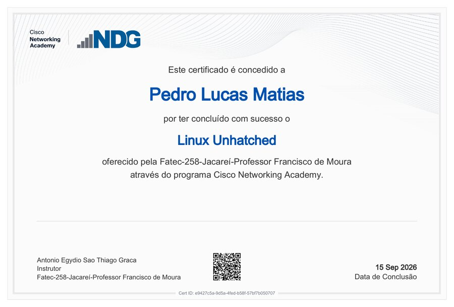
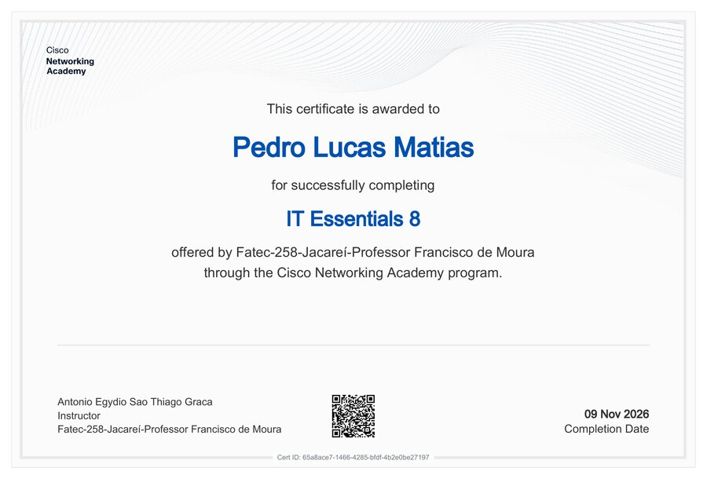

**Certificados de cursos e capacitações, organizados por emissor, com prévia, dados de conclusão e link de verificação oficial.**

[Galeria](#-galeria) · [Certificados](#-certificados) · [Áreas](#-áreas-de-conhecimento) · [Verificação](#-como-verificar) · [Privacidade](#-privacidade-e-uso)

---

> [!NOTE]
> Este é um repositório **pessoal**. Os PDFs são os arquivos originais baixados de cada plataforma, sem edição, e todos
> têm um link de verificação na própria emissora (veja [Como verificar](#-como-verificar)).

Este repositório reúne os certificados dos cursos que concluí durante a graduação em Desenvolvimento de Software
Multiplataforma na Fatec Jacareí e fora dela. Hoje são três: dois da Cisco Networking Academy, oferecidos pela própria
Fatec, e um curso livre de Git, feito na plataforma Cursa. Cada certificado aparece aqui com uma prévia, os dados que
constam no documento e o caminho para conferir a autenticidade na emissora, de modo que quem lê não precisa abrir os PDFs
um a um para saber o que cada um comprova.

## 🏅 Galeria

<table align="center">
  <tr>
    <td align="center"> <b>Linux Unhatched</b> Cisco Networking Academy 15/09/2026</td>
    <td align="center"> <b>Curso básico de Git</b> Cursa 18/09/2026</td>
    <td align="center"> <b>IT Essentials 8</b> Cisco Networking Academy 09/11/2026</td>
  </tr>
</table>

Clique em uma imagem para abrir o PDF original.

## 🎓 Certificados

| # | Curso | Emissor | Instituição | Conclusão | Carga horária | Arquivo |
|---|---|---|---|---|---|---|
| 1 | **Linux Unhatched** | Cisco Networking Academy | Fatec-258 Jacareí | 15/09/2026 | não consta no certificado | [PDF](certificados/cisco-netacad/2026-09-15-linux-unhatched.pdf) |
| 2 | **Curso básico de Git** | Cursa | Cursa (curso livre) | 18/09/2026 | 8 horas, em 8 aulas | [PDF](certificados/cursa/2026-09-18-curso-basico-de-git.pdf) |
| 3 | **IT Essentials 8** | Cisco Networking Academy | Fatec-258 Jacareí | 09/11/2026 | não consta no certificado | [PDF](certificados/cisco-netacad/2026-11-09-it-essentials-8.pdf) |

<b>1. Linux Unhatched</b>

- **Emissor:** Cisco Networking Academy, pelo programa da Fatec-258 Jacareí (Professor Francisco de Moura).
- **Conclusão:** 15 de setembro de 2026.
- **Idioma do certificado:** português.
- **Identificação:** `e9427c5a-9d5a-4fed-b58f-57bf7b050707`.
- **Verificação:** [netacad.com/recognitions/verify/e9427c5a-9d5a-4fed-b58f-57bf7b050707](https://www.netacad.com/recognitions/verify/e9427c5a-9d5a-4fed-b58f-57bf7b050707).
- **Arquivo:** [`certificados/cisco-netacad/2026-09-15-linux-unhatched.pdf`](certificados/cisco-netacad/2026-09-15-linux-unhatched.pdf).

<b>2. Curso básico de Git</b>

- **Emissor:** Cursa (cursa.com.br), curso livre de nível básico, na categoria de educação profissionalizante.
- **Período:** de 15/09/2026 a 18/09/2026, com 8 horas de carga total distribuídas em 8 aulas.
- **Idioma do certificado:** português.
- **Identificação:** `36fbd8812f`.
- **Verificação:** [cursa.com.br/certificate/36fbd8812f](https://cursa.com.br/certificate/36fbd8812f).
- **Arquivo:** [`certificados/cursa/2026-09-18-curso-basico-de-git.pdf`](certificados/cursa/2026-09-18-curso-basico-de-git.pdf).

<b>3. IT Essentials 8</b>

- **Emissor:** Cisco Networking Academy, pelo programa da Fatec-258 Jacareí (Professor Francisco de Moura).
- **Conclusão:** 9 de novembro de 2026.
- **Idioma do certificado:** inglês.
- **Identificação:** `65a8ace7-1466-4285-bfdf-4b2e0be27197`.
- **Verificação:** [netacad.com/recognitions/verify/65a8ace7-1466-4285-bfdf-4b2e0be27197](https://www.netacad.com/recognitions/verify/65a8ace7-1466-4285-bfdf-4b2e0be27197).
- **Arquivo:** [`certificados/cisco-netacad/2026-11-09-it-essentials-8.pdf`](certificados/cisco-netacad/2026-11-09-it-essentials-8.pdf).

## 🧩 Áreas de conhecimento

| Área | Certificado | Nível |
|---|---|---|
| Sistemas operacionais | Linux Unhatched | Introdutório |
| Controle de versão | Curso básico de Git | Básico |
| Fundamentos de TI | IT Essentials 8 | Introdutório |

## 🔎 Como verificar

Cada certificado traz uma identificação própria e um QR code que leva à página de verificação da emissora. Os links
abaixo são os mesmos que o QR code de cada PDF abre.

| Certificado | Identificação | Verificação |
|---|---|---|
| Linux Unhatched | `e9427c5a-9d5a-4fed-b58f-57bf7b050707` | [Cisco Networking Academy](https://www.netacad.com/recognitions/verify/e9427c5a-9d5a-4fed-b58f-57bf7b050707) |
| Curso básico de Git | `36fbd8812f` | [Cursa](https://cursa.com.br/certificate/36fbd8812f) |
| IT Essentials 8 | `65a8ace7-1466-4285-bfdf-4b2e0be27197` | [Cisco Networking Academy](https://www.netacad.com/recognitions/verify/65a8ace7-1466-4285-bfdf-4b2e0be27197) |

> [!TIP]
> A página de verificação da Cisco Networking Academy depende de JavaScript para mostrar os dados do certificado. Se
> aparecer só o título da página, habilite o JavaScript no navegador.

## 🔒 Privacidade e uso

Os PDFs trazem o nome completo e o código de identificação de cada certificado, e por isso o repositório é de leitura e
conferência. As marcas e os layouts da Cisco Networking Academy e da Cursa pertencem às respectivas emissoras. Os
arquivos não devem ser alterados nem apresentados como se fossem de outra pessoa, e a conferência oficial de qualquer
um deles é sempre a da página da emissora.

---

CERTIFICADOS · Pedro Lucas · 2026

